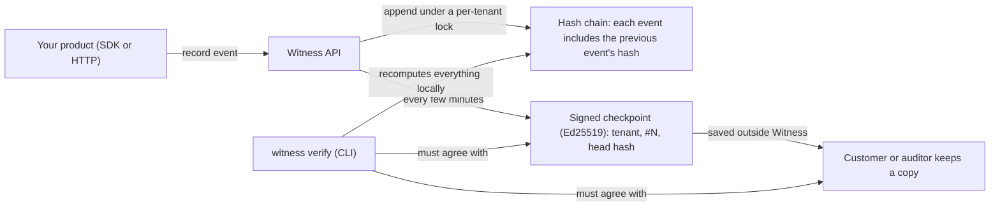

# Witness

[](https://github.com/mengxie/witness/actions/workflows/ci.yml)


[](LICENSE)

**Tamper-evident audit logs for B2B software.** Record who did what, and prove nobody changed the
record afterwards: not an attacker, not a rogue admin, not even someone holding the database and
the signing key.

Enterprise customers ask SaaS vendors for audit trails (SOC 2, ISO 27001, incident response). Most
products answer with a database table that anyone with database access can quietly edit. Witness
is a self-hostable service with an HTTP API, a TypeScript SDK and a verification CLI that make the
log **cryptographically verifiable by your customers and their auditors, without trusting you**.

## How it works



1. **Hash chain.** Every event's hash covers its contents and the previous event's hash. Editing,
   deleting or reordering anything breaks the chain at exactly that event.
2. **Signed checkpoints.** The server periodically signs "tenant T's log has N events ending in hash
   H". A careful attacker who recomputes every hash after an edit still contradicts the signature.
3. **Witnessing.** Customers save checkpoints somewhere Witness cannot reach (`--save-checkpoint`).
   Even with the database _and_ the signing key, history cannot be rewritten past a saved copy.
   The test suite plays exactly this attacker and proves the saved checkpoint catches them.
4. **Redaction without breaking the proof.** Names, IPs and metadata are stored apart from the
   hashed envelope and committed to by a salted digest. Erase them for a GDPR request and the
   chain still verifies.

What each layer catches:

| Someone...                                             | Caught by                                   |
| ------------------------------------------------------ | ------------------------------------------- |
| edits or deletes a row through the app's database role | Refused by the append-only database trigger |
| edits a row as a database superuser                    | Hash chain (`witness verify`)               |
| edits a row and recomputes every later hash            | Signed checkpoints                          |
| does all of that and re-signs with a stolen key        | A checkpoint the customer saved elsewhere   |
| deletes the newest events                              | A saved checkpoint (the log is now shorter) |
| swaps the server's public key                          | Pinning it: `witness verify --public-key`   |

## Quick start

```bash
npm ci
npm run witness -- keygen                 # prints WITNESS_SIGNING_KEY=...
cp .env.example .env                      # paste the key, set WITNESS_ADMIN_TOKEN (32+ chars)
docker compose up --build                 # API on http://localhost:4000
```

Create a tenant (one per customer company) and record an event:

```bash
curl -X POST localhost:4000/admin/tenants -H "authorization: Bearer $WITNESS_ADMIN_TOKEN" \
  -H 'content-type: application/json' -d '{"name":"Acme Ltd"}'
# → { "tenant": { ... }, "apiKey": "wit_..." }   shown once, stored only as a hash

curl -X POST localhost:4000/v1/events -H "authorization: Bearer wit_..." -H 'content-type: application/json' \
  -d '{"action":"invoice.deleted","actor":{"id":"u_42","name":"Aroha"},"target":{"type":"invoice","id":"inv_9"}}'
```

Verify it as an auditor would:

```bash
npm run witness -- verify --url http://localhost:4000 --api-key wit_... --save-checkpoint acme.json
# ✓ Verified 1 events: every one is linked to the last and unaltered.
# ✓ 1 signed checkpoint(s) agree with the log (key 9c41e0...).
```

## SDK

```ts
import { WitnessClient } from '@witness/sdk';

const witness = new WitnessClient({
  baseUrl: 'https://audit.example.com',
  apiKey: process.env.WITNESS_API_KEY!,
});

await witness.record({
  action: 'role.granted',
  actor: { id: user.id, name: user.name },
  target: { type: 'user', id: member.id },
  context: { ip: request.ip },
  metadata: { role: 'admin' },
});

const { events } = await witness.list({ targetType: 'invoice', targetId: 'inv_9' }); // activity feed
const report = await witness.verify({ trusted: savedCheckpoint }); // independent check
```

Every event gets an idempotency key automatically, so the SDK's retries (and yours) can never record
an event twice, even when a response is lost after the server committed.

## API

| Endpoint                                                                            | Purpose                                                                              |
| ----------------------------------------------------------------------------------- | ------------------------------------------------------------------------------------ |
| `POST /v1/events`                                                                   | Record one event, or `{ "events": [...] }` (up to 100, atomic)                       |
| `GET /v1/events`                                                                    | Query newest first: `actorId`, `targetType`, `targetId`, `action`, `before`, `limit` |
| `GET /v1/log`                                                                       | The whole log oldest first, for export and verification                              |
| `POST /v1/events/:id/redact`                                                        | Erase an event's personal data; the proof survives                                   |
| `GET, POST /v1/checkpoints`                                                         | List signed checkpoints, or sign the current head now                                |
| `GET /v1/head`, `GET /v1/verify`                                                    | Current head; server-side verification report                                        |
| `GET /.well-known/witness-key`                                                      | The Ed25519 public key checkpoints are signed with                                   |
| `POST /admin/tenants`, `POST /admin/tenants/:id/keys`, `DELETE /admin/keys/:prefix` | Operator endpoints                                                                   |

Errors are RFC 9457 problem details with stable codes and field-level `errors`.

## Engineering

- **Concurrency:** appends lock the tenant's chain head row, so each tenant's log is strictly
  ordered while tenants never block each other. Idempotency is checked under the lock. A test fires
  40 concurrent requests and verifies a gap-free, valid chain.
- **One source of truth for the format:** `@witness/core` defines canonical JSON (RFC 8785 style),
  hashing and signatures. The server, SDK and CLI all use it, so they cannot disagree.
- **Multi-tenancy:** API keys are random, shown once, stored as SHA-256 hashes and looked up by a
  non-secret prefix; rate limits apply per key; the operator token is compared in constant time.
- **Quality:** TypeScript strict, typescript-eslint `strict-type-checked`, property-based tests
  (fast-check), real-PostgreSQL integration tests, and CI that builds the Docker image and verifies a
  log with the bundled CLI.

## Project structure

```
packages/core/   Log format: canonical JSON, hash chain, redaction, checkpoints, verification
packages/sdk/    WitnessClient: record, query, stream, verify locally
packages/cli/    witness verify | keygen (bundled into a single file)
apps/server/     Fastify API, PostgreSQL store with append-only trigger, checkpointing
docs/adr/        Architecture decision records
```

## Tests

34 tests: the cryptography (including property-based tampering), SDK retry behaviour, the API
against real PostgreSQL (concurrency, idempotency, tenant isolation, redaction, the database
trigger, tamper detection), and end-to-end runs of the SDK and CLI against a live server, including
the stolen-key rewrite.

## Design decisions

1. [A hash chain per tenant, appended under a row lock](docs/adr/0001-hash-chain-per-tenant.md)
2. [Signed checkpoints and witnessing](docs/adr/0002-signed-checkpoints-and-witnessing.md)
3. [Redaction through salted commitments](docs/adr/0003-redaction-through-commitments.md)
4. [One shared core package for the log format](docs/adr/0004-shared-format-package.md)

## Limitations and next steps

- One signing key per deployment; key rotation would keep old public keys published by key id.
- The SDK and CLI use Node's crypto; a browser build would use WebCrypto.
- Retention: pruning old events while keeping a signed checkpoint as the new verification anchor.
- An embeddable viewer so your customers can browse their own audit log inside your product.

## License

[MIT](LICENSE) © Meng Xie
